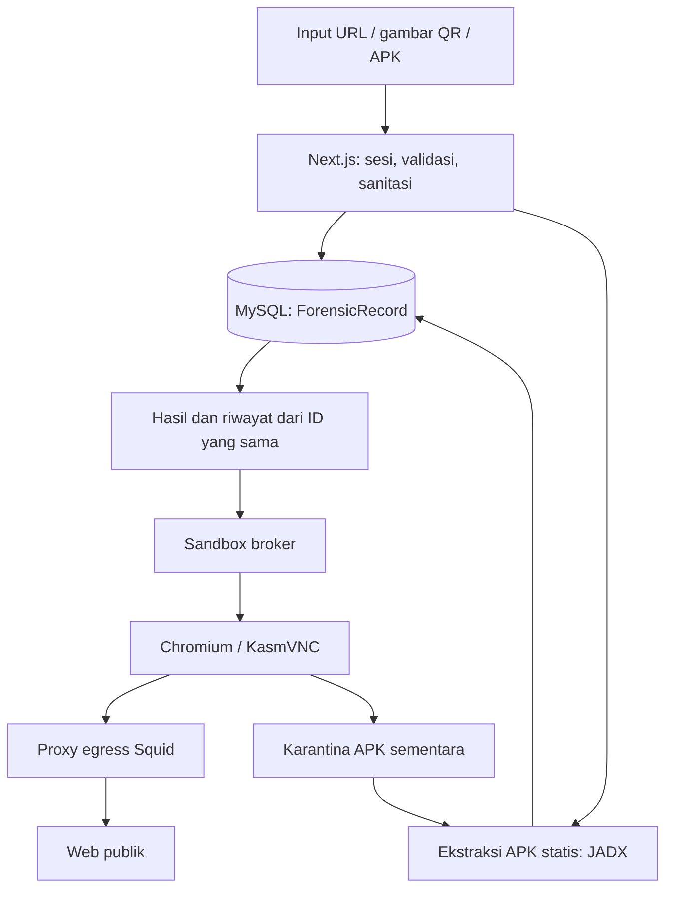

# Arsitektur Sistem Aktif

## Komponen dan alur data

- **Aplikasi:** Next.js App Router, TypeScript, React, Bun, Tailwind v4, dan Prisma/MySQL. UI, sesi, serta API berada pada aplikasi; orkestrasi Docker berada pada broker terpisah.
- **URL/QR:** gambar dibaca oleh Sharp/jsQR. URL langsung dan hasil QR memakai validasi yang sama tanpa menghilangkan provenance jenis input.
- **APK:** arsip diperiksa, kemudian manifest/resource dan DEX diekstrak melalui JADX dalam proses berbatas sumber daya. Binary serta hasil mentah sementara dibersihkan.
- **Rekaman:** `ForensicRecord` menjadi sumber ID, status, metadata, bukti, dan hasil untuk landing serta riwayat. Tidak ada tabel riwayat atau hasil sementara yang menjadi sumber tandingan.

Model AI belum dihubungkan. Input baru berakhir `UNAVAILABLE` dengan risiko `null`, sementara hasil statis APK tetap dapat dibaca. Helper leksikal/DeepSeek lama tidak dipanggil endpoint investigasi. Tidak ada skor pengganti atau proses ulang otomatis.

## Fitur yang bergantung pada hasil

Guardian Share Card serta pengajuan komunitas membaca investigasi lengkap yang tersimpan, dengan sumber/versi model dan bukti valid. Keduanya tidak menghasilkan kesimpulan baru dari target query. Karena model belum aktif, input baru belum dapat membuka fitur tersebut.

Academy dan latihan komunitas menilai jawaban di server serta menyimpan EXP/progres di MySQL. Peringkat anggota menggunakan alias anonim; pengecualian data contoh landing dijelaskan pada [komunitas](./features.md#komunitas-latihan-dan-peringkat).

## Batas kepercayaan

- Browser pengguna menerima UI dan stream sandbox. Situs target berjalan di Chromium server; unduhan tetap dikarantina di server.
- Server memvalidasi sesi database, peran, pemilik rekaman, Origin mutasi, dan input. Query atau ID tidak memberikan hak akses.
- Next tidak memegang socket Docker. Broker tepercaya mengalokasikan browser, proxy, serta jaringan per sesi dengan deadline 180 detik.
- Koneksi browser melewati proxy egress yang memblokir alamat lokal dan metadata. Clipboard, akses perangkat, serta transfer lokal diblokir.
- Teks melewati [PII Scrubber](../lib/security/pii-scrubber.ts) dan [sanitasi investigasi](../lib/investigations/privacy.ts) sebelum persistensi atau pengiriman ke layanan AI. Snapshot komunitas dan Share Card menyaring ulang konten sesuai tujuan publikasinya.
- Container berbagi kernel host. Batas runtime, jaringan, dan deployment harus mengikuti panduan khususnya.

## Rujukan kontrak

Perilaku fitur berada pada [features.md](./features.md), sedangkan setup dan batas runtime berada pada [deployment.md](./deployment.md). Diagram hanya menggambarkan komponen aktif.
